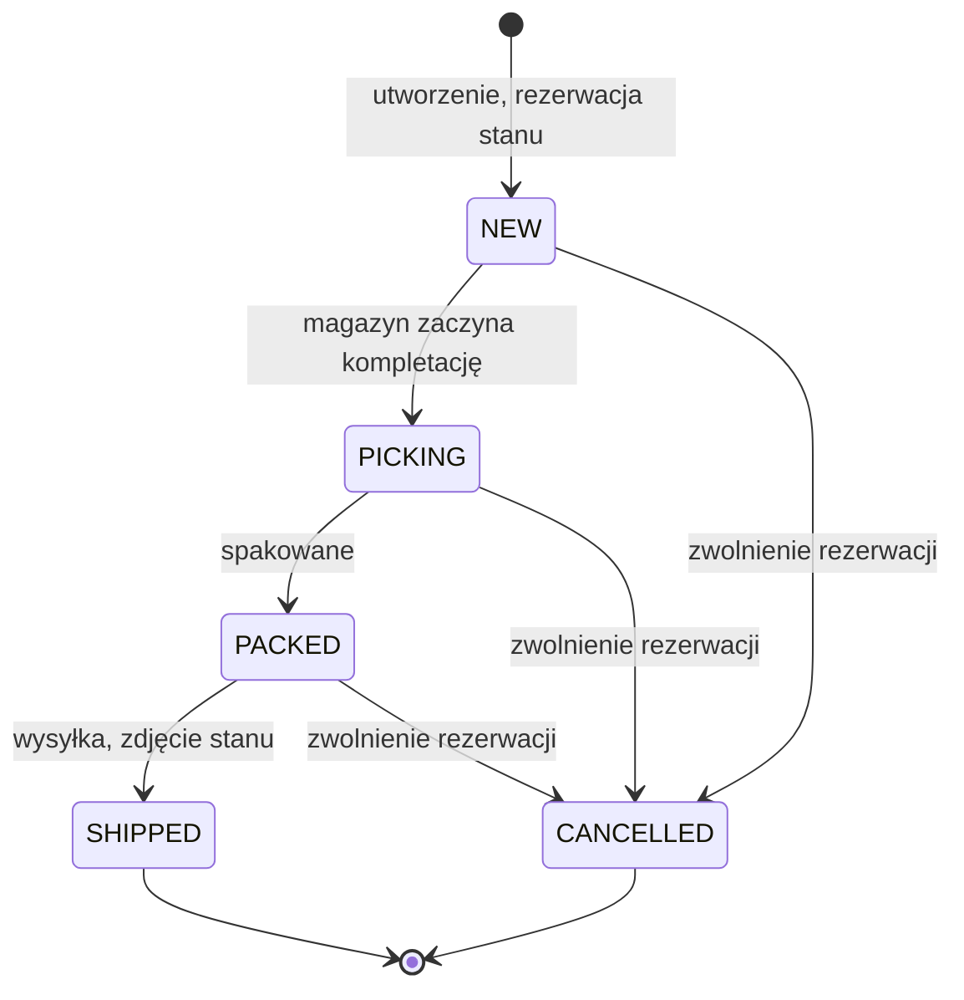

# FulfillHub – model danych

Siedem encji. Sklep jest właścicielem produktów i zamówień, więc to przez `shop_id` przechodzi
cały podział danych między sklepami (rola `SHOP` widzi wyłącznie swoje wiersze).

```mermaid
erDiagram
    SHOPS ||--o{ USERS : "ma konta"
    SHOPS ||--o{ PRODUCTS : "posiada"
    SHOPS ||--o{ ORDERS : "składa"
    PRODUCTS ||--o{ STOCK_MOVEMENTS : "historia"
    PRODUCTS ||--o{ ORDER_ITEMS : "w pozycjach"
    ORDERS ||--|{ ORDER_ITEMS : "zawiera"
    ORDERS ||--o| SHIPMENTS : "wysłane jako"
    ORDERS ||--o{ STOCK_MOVEMENTS : "powoduje"
    USERS ||--o{ STOCK_MOVEMENTS : "wykonał"

    SHOPS {
        int id PK
        string name
        string contact_email
        boolean is_active
        timestamptz created_at
    }
    USERS {
        int id PK
        string email UK
        string password_hash
        string role "ADMIN | WAREHOUSE | SHOP"
        int shop_id FK "NULL dla ADMIN i WAREHOUSE"
        boolean is_active
        timestamptz created_at
    }
    PRODUCTS {
        int id PK
        int shop_id FK
        string sku "UNIQUE w ramach sklepu"
        string name
        string ean "nullable"
        int quantity_on_hand
        int quantity_reserved
        int low_stock_threshold
        int version
        timestamptz created_at
        timestamptz updated_at
    }
    STOCK_MOVEMENTS {
        int id PK
        int product_id FK
        string type "RECEIPT | ADJUSTMENT | RESERVATION | RELEASE | SHIPMENT"
        int quantity "ze znakiem"
        string reason "nullable"
        int order_id FK "nullable"
        int user_id FK "nullable"
        timestamptz created_at
    }
    ORDERS {
        int id PK
        int shop_id FK
        string external_ref "UNIQUE w ramach sklepu"
        string status "NEW | PICKING | PACKED | SHIPPED | CANCELLED"
        string recipient_name
        string recipient_address
        string recipient_email "nullable"
        timestamptz created_at
        timestamptz cancelled_at "nullable"
    }
    ORDER_ITEMS {
        int id PK
        int order_id FK
        int product_id FK
        int quantity "> 0"
    }
    SHIPMENTS {
        int id PK
        int order_id FK UK
        string carrier
        string tracking_number
        timestamptz shipped_at
    }
```

## Ograniczenia pilnowane przez bazę
Reguły siedzą w services, ale te, które da się wyrazić w schemacie, są dodatkowo zabezpieczone
w bazie — service może mieć błąd, baza jest ostatnią linią obrony.

| Tabela | Ograniczenie | Po co |
|---|---|---|
| `products` | `UNIQUE (shop_id, sku)` | SKU identyfikuje towar w obrębie sklepu |
| `products` | `CHECK (quantity_on_hand >= 0)` | stan nie może zejść poniżej zera |
| `products` | `CHECK (quantity_reserved >= 0)` | rezerwacja nie może być ujemna |
| `products` | `CHECK (quantity_reserved <= quantity_on_hand)` | nie da się zarezerwować towaru, którego nie ma |
| `orders` | `UNIQUE (shop_id, external_ref)` | numer zamówienia jest unikalny u danego sklepu |
| `order_items` | `CHECK (quantity > 0)` | pozycja z zerową ilością nie ma sensu |
| `order_items` | `UNIQUE (order_id, product_id)` | jeden produkt raz na zamówienie |
| `users` | `CHECK (role IN (...))` | tylko znane role |
| `users` | `CHECK` roli i `shop_id` | konto SHOP musi mieć sklep, pozostałe nie mogą |
| `stock_movements` | `CHECK (type IN (...))` | tylko znane typy ruchów |
| `shipments` | `UNIQUE (order_id)` | jedno zamówienie to jedna przesyłka |

## Stan dostępny i historia ruchów
`dostępne = quantity_on_hand - quantity_reserved` — liczone przy każdej odpowiedzi, nie trzymane
w bazie, żeby nie dało się rozjechać z prawdą.

Znak w `stock_movements.quantity` jest dobrany tak, by historia sumowała się do stanu:

| Typ ruchu | Znak | Wpływ |
|---|---|---|
| `RECEIPT` | `+q` | przyjęcie dostawy podnosi stan |
| `ADJUSTMENT` | `±delta` | korekta inwentaryzacyjna |
| `RESERVATION` | `+q` | zamówienie blokuje towar |
| `RELEASE` | `-q` | anulowanie zwalnia blokadę |
| `SHIPMENT` | `-q` | wysyłka zdejmuje towar i zwalnia blokadę |

Stąd dwa niezmienniki, które można sprawdzić zapytaniem w dowolnym momencie:

- `RECEIPT + ADJUSTMENT + SHIPMENT = quantity_on_hand`
- `RESERVATION + RELEASE + SHIPMENT = quantity_reserved`

## Cykl życia zamówienia



Rola `SHOP` może anulować tylko w statusie `NEW`; później zamówienie jest już w rękach magazynu.
